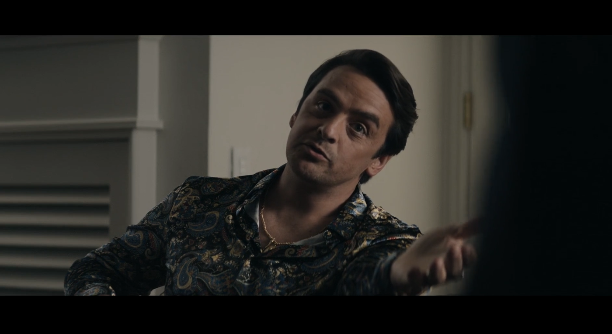

# Auri

**Canvas desktop para agentes CLI, terminais e notas conectados pelo usuário.**

Auri é uma interface gráfica local (Rust + GPUI) onde você abre agentes de
terminal, terminais comuns e blocos de nota, conecta os cartões no canvas e
deixa os agentes colaborarem **somente através das conexões que você desenhou**.
Um CLI local (`auri`) roda dentro de cada agente e fala com o host por um
socket Unix com token por terminal — sem proxy de modelo, sem protocolo de
rede e sem exigir patch nos CLIs de agente.

> Ferramenta pessoal, open-source sob MIT. Veja [NOTICE.md](NOTICE.md): issues
> e PRs são bem-vindos, mas não há compromisso de suporte.



## O que já funciona

- **Canvas**: cartões de agente, terminais e notas com drag, resize, zoom e
  persistência em JSON.
- **Conexões**: selecione um cartão, clique no ícone de conexão na ilha
  direita e clique no destino. A aresta aparece como linha tracejada. Só o
  usuário cria conexões.
- **Dois papéis**: agente normal e administrador. O toggle fica no diálogo
  `Editar` (botão direito no agente). O administrador cria/remove terminais,
  notas e agentes; o normal lê/escreve notas, comanda terminais e conversa
  com agentes conectados.
- **CLI `auri`**: `list`, `ask [--raw]`, `check`, `note read|write|edit`, e,
  para administradores, `note create|delete`, `terminal new|remove`,
  `agent new|remove|role`. `auri skill` imprime o skill distribuído.
- **Mensagens assíncronas**: quem envia inclui no prompt o comando de resposta
  (`auri ask "Nome" "resultado"`) e continua trabalhando.
- **Desempenho**: renderer de terminal com cache por linha e damage tracking,
  batched glyph runs, resize de PTY adiado durante zoom, e build dev com
  dependências otimizadas.
- **Regressões**: suíte de código + suíte visual com goldens para canvas vazio,
  linha tracejada e diálogo centralizado.

## Stack

Rust 2024 (rust-version 1.90), GPUI/auro, alacritty_terminal, portable-pty,
gpui-component, serde, Unix domain sockets, Windows/macOS não testados.

## Começando

```bash
# Release
cd canvas
cargo run --release

# Dev (hot reload via Auro CLI, se instalado)
auro dev --dir canvas
```

## Instalação no Linux (release estável)

```bash
curl -fLO https://github.com/pdl-clay/auri/releases/latest/download/install-appimage.sh
chmod +x install-appimage.sh
./install-appimage.sh
```

O script verifica a assinatura Ed25519 dos manifestos com a chave pública
fixada em `Auro.toml`, confere tamanho e SHA-256, e instala o AppImage como
`~/.local/bin/auri-canvas`, o CLI `auri` como `~/.local/bin/auri` e uma entrada
no menu do desktop. Use `--help` para instalar um AppImage arbitrário ou
escolher outro diretório.

O estado fica em `$XDG_CONFIG_HOME/auro-canvas/workspaces.json`
(padrão: `~/.config/auro-canvas/workspaces.json`). A primeira vez o canvas
abre sem nada carregado; clique no espaço de trabalho na lateral para carregar
os cartões salvos.

Para desenvolver com o mesmo desempenho do modo release, o perfil `dev` em
`canvas/Cargo.toml` compila as dependências em `opt-level = 3` com debug
assertions desligadas. O primeiro build é mais demorado.

## Arquitetura (resumo)

```
agente CLI (dentro do PTY)
  |  auri <verbo>  (linha JSON + token)
  v
host Auri (Rust)
  - registry de token por cartão -> workspace
  - permissions::authorize(workspace, identidade, ação)
  - dispatch: escreve bytes no PTY / lê tela / muta notas e cartões
```

O host é o único dono do estado do canvas e dos PTYs. O CLI não escreve
config, não chama shell com texto do request e não usa A2A/MCP. O transporte é
um socket Unix local com permissão 0600;

## Estrutura

```
canvas/
  src/            entry point (Auro)
  ui/             canvas, cartões, notas, permissões, PTY, renderer
  types/          modelo persistido (workspaces, cartões, conexões, papéis)
  protocol/       codec JSON por linha compartilhado host/CLI
  auri-cli/       binário `auri`
  skills/auri/    skill distribuído para os agentes
  vendor/         fork local do gpui-terminal (PATCHES.md)
  scripts/        utilitários de teste visual
  tests/visual/   fixture e goldens
docs/superpowers/ spec e plano de implementação
```

## Testes

```bash
cd canvas
cargo test --workspace
./scripts/visual-regression.sh --check   # requer Wayland/niri + grim + magick
```

A suíte visual usa goldens com tolerância de 0,5% de pixels e um helper
wlr-virtual-pointer próprio; ela depende de um ambiente Wayland/niri
determinístico.

## Contribuindo

Leia [CONTRIBUTING.md](CONTRIBUTING.md). Resumo: abra uma issue para bugs ou
ideias, abra PR para mudanças, rode os testes. Não há promessa de resposta
rápida nem de suporte — veja [NOTICE.md](NOTICE.md).

## Licença

MIT — veja [LICENSE](LICENSE) e a segunda parte em [NOTICE.md](NOTICE.md).
